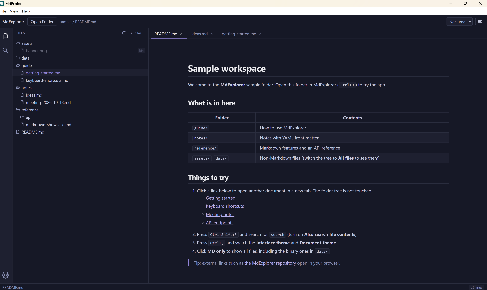

<div align="center">


# MdExplorer

**A fast, VS Code-style desktop browser for Markdown folders.**
Open a huge docs folder instantly, search it without freezing, and read in a theme you like.

[](LICENSE)


**English** · [简体中文](README.zh-CN.md)

</div>

<p align="center">
  
</p>

---

## ✨ Features

| | |
|---|---|
| ⚡ **Instant open, lazy tree** | Only one folder level is read at a time, when you expand it. Huge folders never freeze the UI. |
| 🔎 **Background search** | Search Markdown file names, or file contents too. Results stream in, you can stop it any time, and you keep working while it runs. |
| 🗂️ **VS Code-style sidebar** | Activity bar with Explorer, Search and Settings. Click the active icon to collapse the sidebar. |
| 📑 **Multi-tab reading** | Many documents at once, tab context menu, and a quick tab switcher (`Ctrl+Shift+E`). |
| 🔗 **Smart links** | Links to other `.md` files open in a tab (never twice for the same file) without touching the tree. External links open in your browser. |
| 🎨 **Two kinds of themes** | Interface: Nocturne, Light, Graphite, High contrast. Document: Nocturne, GitHub, Nord, Dracula, Plain. |
| 🧠 **Remembers your session** | Last folder, open tabs, active tab, scroll positions, window size and themes. You are asked before the previous folder is reopened. |
| 🖥️ **Multi-monitor safe** | If the window was last on a monitor you disconnected, it reopens on your primary display. |
| 📝 **Rich Markdown** | Syntax-highlighted code, tables, blockquotes, GitHub-flavored Markdown and a YAML front-matter table. Embedded scripts are stripped. |

## 🚀 Getting started

### Build and install

There is no prebuilt download yet, so you build the installer yourself. You must build on the operating system you are targeting (installers cannot be cross-built).

```bash
# 1. Get the code
git clone git@github.com:czhou-perosnal-share/mdexplorer.git
cd mdexplorer

# 2. Install dependencies
npm install

# 3. Build the installer / package for your current OS
npm run make
```

The result is written to `out/make/`:

| Platform | Output | How to install |
|---|---|---|
| Windows | `out/make/squirrel.windows/x64/MdExplorer-<version> Setup.exe` | Run it. It installs silently (no wizard) to `%LOCALAPPDATA%\MdExplorer` and adds Start menu and desktop shortcuts. |
| macOS | `out/make/zip/darwin/<arch>/MdExplorer-darwin-<arch>-<version>.zip` | Unzip and drag `MdExplorer.app` to `Applications`. |
| Linux (Debian/Ubuntu) | `out/make/deb/<arch>/*.deb` | `sudo dpkg -i <file>.deb` |
| Linux (Fedora/RHEL) | `out/make/rpm/<arch>/*.rpm` | `sudo rpm -i <file>.rpm` |

Linux builds additionally need the packaging tools on the build machine (`dpkg` and `fakeroot` for `.deb`, `rpmbuild` for `.rpm`).

Want to try the app without installing? Run `npm start` for a development window, or `npm run package` to produce an unpacked app in `out/` that you can launch directly.

To update, pull the latest code, run `npm run make` again and re-run the installer. On Windows, `scripts/reinstall.ps1` does all of this in one step: build, uninstall the old version and install the new one.

### Open a folder

- Use **File → Open Folder…** (`Ctrl+O`) or the **Open Folder** button, or
- start the app with a folder argument:

```bash
mdexplorer /path/to/docs
```

## ⌨️ Keyboard shortcuts

| Shortcut | Action |
|---|---|
| `Ctrl+O` | Open folder |
| `Ctrl+,` | Settings |
| `Ctrl+Shift+F` | Search files |
| `Ctrl+Shift+E` | Tab switcher |
| `Ctrl+Tab` / `Ctrl+Shift+Tab` | Next / previous tab |
| `Ctrl+W` | Close active tab |
| `F5` | Refresh the folder tree |
| `↑` `↓` / `k` `j` | Navigate the tree, or scroll the document |
| `←` `→` | Collapse / expand the selected folder |
| `PgUp` `PgDn` · `Home` `End` | Page scroll · document start / end |
| `Enter` | Open file / toggle folder |
| `?` | Show the shortcut list |
| `Ctrl+Q` | Quit |

## 🛠️ Development

Requirements: a recent Node.js (developed on v24) and npm.

```bash
npm install
npm start          # run in development mode
npm test           # unit tests (Vitest)
npm run make       # build an installable package into out/make
```

**Tech stack:** Electron + [Electron Forge](https://www.electronforge.io/) (Vite plugin), React 19, TypeScript, `marked`, `highlight.js`, `electron-store`.

```
src/
├── main/       # Electron main process: file listing, search, link resolution, state store
├── preload/    # Safe IPC bridge exposed to the renderer
└── renderer/   # React UI: sidebar, tree, search, tabs, viewer, themes
openspec/       # Specs and change history (OpenSpec)
```

> **Dependency note:** `electron-store@8`, `@vitejs/plugin-react@4` are pinned on purpose — newer majors are ESM-only and break the Vite CommonJS main-process build.

## 💾 Where settings are stored

| Platform | Path |
|---|---|
| Windows | `%APPDATA%\mdexplorer\config.json` |
| macOS | `~/Library/Application Support/mdexplorer/config.json` |
| Linux | `~/.config/mdexplorer/config.json` |

## 🤝 Contributing

Issues and pull requests are welcome. Please read [CONTRIBUTING.md](CONTRIBUTING.md) for the workflow, and [docs/TECH.md](docs/TECH.md) for the tech stack, folder structure and architecture. Behavior changes are tracked as OpenSpec changes under [`openspec/`](openspec/).

## 📄 License

[MIT](LICENSE) © 2026 czhou-perosnal-share
